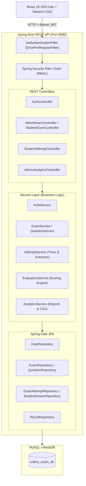

# Examify — Online Examination & Assessment Platform

<div align="center">
  
  
  
  
  
  
  
</div>

<br />

**Examify** is an enterprise-grade, full-stack Online Examination and Assessment Platform engineered with **Java, Spring Boot 3, React 18, and MySQL**. It provides robust, role-based workflows for administrators to design timed examinations and students to take tests with live server-side countdown timers, periodic autosaving, and instant automated objective scoring.

---

## 🌟 Key Features

### 🛡️ Security & Integrity (Zero-Trust Model)
- **Role-Based Access Control (RBAC)**: Strict segregation between `ROLE_ADMIN` and `ROLE_STUDENT` enforced via Spring Security 6 and stateless JJWT (JSON Web Tokens).
- **BCrypt Password Encryption**: Strong cryptographic salting and hashing for all stored credentials.
- **Zero-Trust Client Scoring**: Correct answer keys (`isCorrect`) are completely stripped from student examination payloads to prevent client-side inspection via browser DevTools.
- **Server-Authoritative Timer**: Examination durations are strictly computed and enforced on the server to prevent device clock or JavaScript manipulation.

### 🎓 Student Examination Experience
- **Interactive Question Palette**: Live status grid tracking *Answered* (Emerald), *Marked for Review* (Purple), and *Unvisited* (Gray) questions.
- **Periodic Background Autosave**: Real-time HTTP persistence to `student_answers` on every selection.
- **Interrupted Session Recovery**: Allows students to refresh or reconnect after network interruptions and seamlessly resume their attempt with accurate remaining server time.
- **Instant Automated Scorecard**: Immediate evaluation on submission displaying total score, percentage, pass/fail status, and question-by-question review.

### 📊 Administrative Suite & Analytics
- **Exam & Question Bank CRUD**: Create, edit, and delete examinations with customizable duration, pass marks, allowed attempts, and difficulty levels (`EASY`, `MEDIUM`, `HARD`).
- **Publish State Machine**: Toggle exams between `DRAFT` and `PUBLISHED` states.
- **Deep Analytics (Recharts)**: Interactive bar charts and diagnostic tables breaking down question-level accuracy to identify student learning gaps.
- **1-Click CSV Export**: Instant generation and download of complete student leaderboards and submission data in CSV format.
- **Immutable Audit Trail**: Chronological event logs tracking critical administrator modifications.

---

## 🏗️ Architecture & Workflows

### 3-Tier Layered Architecture


---

## 🗄️ Database Schema Design

The relational database model consists of 8 core tables:

| Table | Purpose |
|---|---|
| `users` | Administrator and student credentials, BCrypt hashes, and roles |
| `exams` | Exam metadata, time limits, total marks, pass marks, and publish status |
| `questions` | Question text, marks, difficulty tags, and exam foreign keys |
| `options` | Multiple-choice choices (4 per question) with server-side `is_correct` flags |
| `exam_attempts` | Attempt lifecycle state (`IN_PROGRESS`, `SUBMITTED`, `EXPIRED`) and server timestamps |
| `student_answers` | Autosaved user choices and "Mark for Review" flags per question |
| `results` | Calculated scorecards, percentage, and pass/fail indicators |
| `audit_logs` | Chronological administrative actions and security logs |

---

## 🚀 Quick Start Guide

### Prerequisites
- **Java**: JDK 17, 21, or 23 installed
- **Node.js**: v18+ and npm installed
- **MySQL / MariaDB**: Running on port 3306 (e.g., via XAMPP)
- **Maven**: 3.8+ installed (or bundled)

### 1. Database Configuration
Open MySQL and create the database:
```sql
CREATE DATABASE IF NOT EXISTS online_exam_db;
```
Configure your credentials in `backend/src/main/resources/application.properties`:
```properties
spring.datasource.url=jdbc:mysql://localhost:3306/online_exam_db?useSSL=false&serverTimezone=UTC&allowPublicKeyRetrieval=true
spring.datasource.username=root
spring.datasource.password=
```

### 2. Start Backend (Spring Boot)
```bash
cd backend
mvn clean compile
mvn spring-boot:run
```
*Backend runs at:* `http://localhost:8080`

### 3. Start Frontend (React + Vite)
```bash
cd frontend
npm install
npm run dev
```
*Frontend runs at:* `http://localhost:5173`

---

## 🔑 Pre-Configured Demo Accounts

The database seeder automatically creates two test accounts:

| Role | Email | Password | Permissions |
|---|---|---|---|
| **Student** | `student@exam.com` | `studentpassword` | Browse exams, take timed tests, review scorecards |
| **Administrator** | `admin@exam.com` | `adminpassword` | Exam builder, question bank, student results, analytics, CSV export |

---

## 🧪 Testing Suite

Run the automated JUnit 5 & Mockito test suite:
```bash
cd backend
mvn test
```

---

## 📄 License
This project is licensed under the MIT License.
